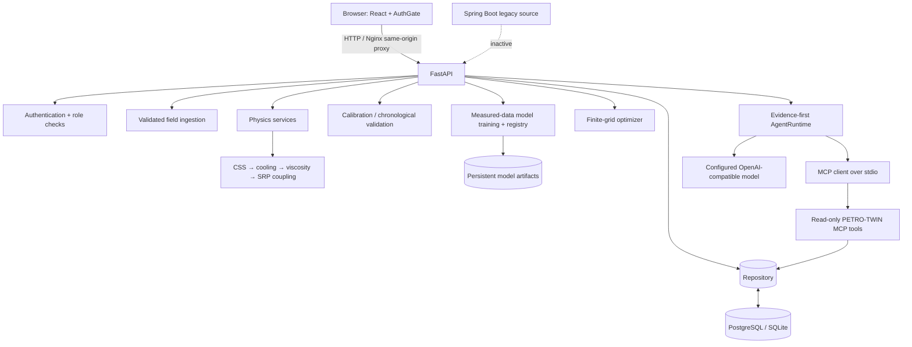

# System Architecture

**Active backend:** FastAPI / Python. **Frontend:** React 19 / TypeScript. **Persistent store:** PostgreSQL in Compose and SQLite in local development. Spring Boot remains legacy/dormant source and is not on the frontend request path.

## Current runtime

## Connected request paths

- React calls FastAPI through `frontend/src/services/api.ts`. The AuthGate checks `/health` and validates the signed session through `/api/v1/auth/me` when auth is required.
- FastAPI is the authority for request validation, role enforcement, domain orchestration and repository transactions.
- Field ingestion supports CSV/JSON measurements with unit normalization, quality status, source identity, duplicate/rejection handling and provenance. No live historian/SCADA/OPC-UA/MQTT connector is configured.
- The coupled CSS–SRP simulation explicitly passes CSS heat/soak state to thermal cooling, then viscosity, then SRP mechanics. Scenario and optimizer candidates return the intermediate coupling chain.
- Calibration currently has a viscosity fit adapter. CSS thermal and SRP parameter fitting remain blocked by data/identifiability gaps.
- Field ML training consumes only VALID measurements, builds as-of feature vectors and future oil-rate targets, uses chronological train/validation/test splits, compares against a persistence baseline, fingerprints the dataset, hashes artifacts and registers review candidates. Model promotion is explicit and admin-only; synthetic model artifacts remain separate.
- The industrial investigation agent retrieves evidence from the shared repository via the read-only MCP server, calls a configured LLM, and stores the tool trace.
- The optimizer remains a finite-grid search with weighted ranking and nondominated filtering. It is a model-based candidate comparison, not a validated multiobjective solver or automated control system.

## Persistence and artifact lifecycle

PostgreSQL is the Compose database; SQLite supports local development and isolated tests. Versioned schema migrations cover well records, measurements, operational data, calibration evidence, authentication sessions/audit, agent runs and model registry. The Compose stack persists PostgreSQL data and measured-data model artifacts in named volumes. Field model artifacts are integrity-checked against the registry SHA-256 before inference/promotion.

## Security

Local development may explicitly use `PETROTWIN_AUTH_MODE=disabled`. The production Compose overlay sets `PETROTWIN_AUTH_MODE=required` and refuses to start without `PETROTWIN_JWT_SECRET` of at least 32 bytes. Passwords are scrypt-hashed; JWTs are signed and backed by revocable database sessions. Roles are viewer, engineer, operator and admin. All application API paths are protected in required mode; health and login stay public. The admin CLI creates the first administrator without a default password.

The current security boundary is application-level authentication and authorization. HTTPS termination, edge rate limiting, CSP, external identity provider, secret-manager integration and independent security testing still require deployment-specific configuration before public exposure.

## Simulation versus field evidence

- Built-in demo wells, simulated telemetry, legacy synthetic model artifacts, and simulation candidates are not field evidence.
- Field mode does not seed demo wells. Missing/stale/invalid measurements must produce unavailable results; they are not replaced with generated telemetry.
- The coupled CSS–SRP model reports `SIMULATION_ONLY`, `field_eligible=false`, and `NOT_CALIBRATED_ON_FIELD_DATA`.
- ML candidates require measured VALID observations and explicit promotion, but chronological holdout performance is not independent field validation.
- No production deployment, field calibration or field validation is claimed until actual operator data and domain review are supplied.

## Spring Boot

The Java source and Flyway scripts remain in the repository as legacy code. They are not part of Compose's active request path. FastAPI is the single service boundary to avoid two backends with different persistence/security implementations.
