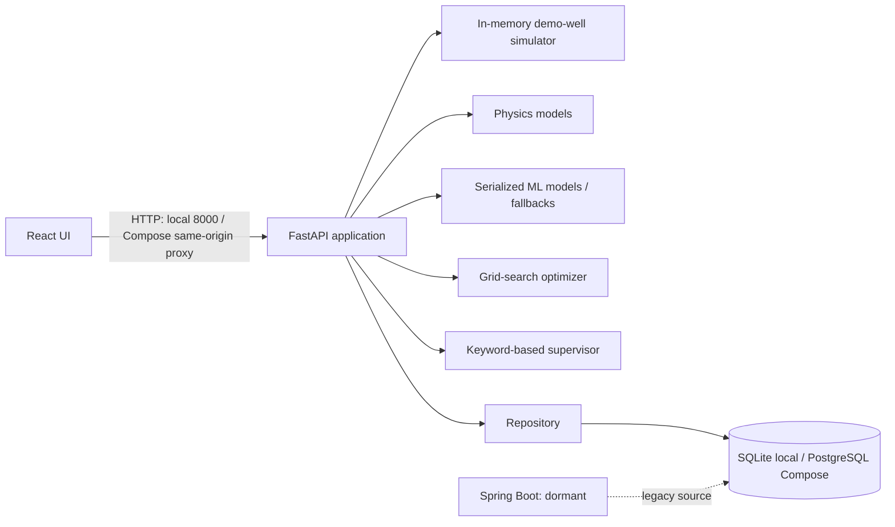

# PETRO-TWIN AI Architecture Audit

**Audit basis:** repository source, tests, configuration, migrations, and documentation inspected on 2026-11-22. Follow-up stabilization changes and checks are recorded below. Claims distinguish code present from behavior described only in documentation.

## Summary

PETRO-TWIN is a synthetic CSS + SRP demonstration: CSS means Cyclic Steam Stimulation and SRP means Sucker Rod Pumping. The intended problem is to relate post-steam thermal/viscosity decline to pump loading and rod-floating/failure risk, then compare production, steam/energy, and mechanical-risk tradeoffs. It is not connected to Baghewala field telemetry. The active path is React → FastAPI → Python models/simulator/optimizer. Spring Boot source and SQL migrations remain dormant. FastAPI now has a small SQLite/PostgreSQL repository for configured wells and saved analysis runs.

The most defensible near-term architecture is a **single FastAPI application** for HTTP/API, domain orchestration, and physics/ML computation, with **PostgreSQL as the persistent store** and React as the only client. The existing Spring Boot layer should leave the active local runtime path unless a concrete responsibility requiring it is implemented. Keep simulation mode explicit and isolate it from any future measured-data mode.

## Existing architecture and actual execution flow

### Component responsibilities

| Component | Actual responsibility | Status |
|---|---|---|
| `frontend/` | React dashboard, polling, visualizations, and API-driven CSS/SRP/scenario workflows | Implemented synthetic demo UI; failures surface as errors |
| `ml_service/main.py` | FastAPI routes for wells, telemetry, prediction, simulation, optimization, copilot, WebSocket | Main functioning backend/API path |
| `physics/` | Temperature/viscosity calculations, 1D profile, approximate SRP mechanics and dyno-card synthesis | Approximate simulator calculations |
| `ml_service/simulator/` | Three hard-coded demo-well definitions; generated telemetry, time-machine states, and synthetic history | Simulation only; generated state is not measured or persisted telemetry |
| `ml_service/models/` | Production residual prediction, failure-risk estimation, Isolation Forest/heuristics | Mixed trained artifacts and deterministic approximations |
| `ml_service/optimizer/` | Finite candidate grid, implemented constraint filtering, weighted recommendation, nondominated filtering | Not NSGA-II/SLSQP/LHS; synthetic estimates and simplified assumptions |
| `agent/` | Keyword intent detection and deterministic function calls; static history records | Not an LLM agent, RAG system, or durable audit workflow |
| `backend/springboot/` | A few REST proxy controllers, WebSocket broker config, Flyway schema and seed SQL | Dormant source; no runtime service in the canonical stack |
| `docker-compose.yml` | PostgreSQL, FastAPI, frontend containers | Spring Boot is intentionally outside the default stack; Nginx routes to FastAPI |
| `data/` | YAML source/governance registry | No registered source dataset or ingestion adapter implementation found |

## Feature-by-feature implementation status

| Feature | Implemented | Important limit |
|---|---|---|
| Demo well configuration | Yes, seeded to SQLite/PostgreSQL and loaded by FastAPI | Telemetry remains generated in memory; no measured state |
| CSS temperature response | Yes, simplified energy estimate and exponential decline | Fixed assumptions; no history assimilation or spatial thermal model |
| Viscosity | Yes, Walther-style temperature relation and pressure adjustment | Defaults/calibration need independent unit/curve verification |
| Wellbore profile | Yes, segmented interpolation | No coupled transient flow/heat solver |
| SRP mechanics | Yes, approximate load/drag/power/fill calculations and synthetic card | Not a validated API RP 11L solver; assumptions require review |
| Production prediction | Yes, physics baseline + saved residual model with deterministic fallback | Synthetic training; range is heuristic and uncalibrated |
| Failure risk | Yes, physics score and optional classifiers | Risk probabilities are not calibrated; explanations are hand-weighted, not SHAP |
| Anomaly detection | Yes, Isolation Forest and hard-coded thresholds | Synthetic baseline; no streaming-window logic or field labels |
| Optimization | Yes, finite grid, weighted recommendation, and actual nondominated filtering among feasible candidates | Candidate objectives/constraints are simplified; not field-calibrated and does not dispatch |
| Copilot | Yes, simple keyword branches | No LLM, RAG, general tool planner, real confirmation, or persistent audit |
| Live telemetry | WebSocket endpoint sends generated frames | Simulated frame generation, no live source; frontend uses polling instead |
| Historical telemetry | Generated per request | Not stored history |
| Database persistence | FastAPI repository stores configured well records and user-triggered analysis runs | Telemetry remains generated; repository is not a migration-managed enterprise schema |
| Human approval / dispatch | UI states recommendations are review-only | No approval ledger or dispatch integration |
| Tests | Physics/model tests plus API and repository tests | No browser journey, PostgreSQL integration, deployment, or measured-data validation |

## Current broken connections, duplication, and technical debt

1. **Spring Boot remains legacy source:** it is not used by the app's canonical API path. Nginx and Compose now route/run FastAPI only.
2. **Persistence scope is intentionally narrow:** configured well records and explicit analysis runs persist. Telemetry is generated and forecasts/risk results are not individually stored.
3. **Simulation only:** no data adapter connects SCADA/OPC-UA or any field dataset. Never interpret synthetic predictions as operating instructions.
4. **Telemetry consistency:** each request may generate a new noisy frame; the UI does not yet operate on a shared immutable snapshot across all panels.
6. **Optimizer scope:** candidate evaluation is a simplified finite grid with weighted recommendation and nondominated filtering. It is not a validated multiobjective solver or control system.
7. **Synthetic evaluation leakage/limited generalization:** training examples and targets are generated from the same project physics/rules; random row splits do not test held-out wells, cycles, time periods, or field measurements.
8. **Claimed explainability and uncertainty are ungrounded:** failure feature percentages are hand formulas; forecast bands are fixed percentages; model registry/health metadata contains fixed values rather than live artifact and metric inspection.
9. **Configured data adapters are absent:** the registry's CSV/Postgres/REST/MQTT interfaces are declarations, not code paths.
10. **No dispatch/audit workflow:** applying a plan displays a review-only notice; no action is dispatched, approved, or audit-logged.

## Security and reliability findings

- CORS is restricted to configured origins and defaults to local development origins. Compose sets its frontend origin explicitly.
- Compose loads PostgreSQL credentials through required environment variables and does not publish the database host port.
- No authentication or authorization is present in the inspected FastAPI routes or Spring controllers. The schema's user and role tables do not implement access control.
- Spring Boot's Actuator health endpoint is configured to show details; confirm exposure and network restrictions before deployment.
- No structured request/error logging, request IDs, or rate limits are implemented. Input bounds exist but are broad software limits, not validated field envelopes.
- The API is unauthenticated and intended only for local demonstration; do not expose it to operational networks.
- `ml_service/config.py` points `models_dir` and data/config paths to parent locations that do not match the actual artifact directory layout; some values are informational today, but should be corrected or removed.
- Demo seed SQL contains user rows and a fixed bcrypt-like string; no authentication consumes them. Do not treat those accounts as a functioning security boundary.

## Data flow and performance risks

- The frontend polls telemetry, dyno cards, and failure estimates every 10 seconds. Forecast and optimizer calls are user-triggered; optimizer work is no longer repeated on each poll.
- Several outputs are not keyed to a single immutable snapshot. UI panels may display outputs calculated from different randomized telemetry frames.
- WebSocket traffic is generated on demand, not derived from persisted incoming telemetry, and the client does not use it.
- Synthetic training records, benchmark claims, UI defaults, and API defaults have multiple parameter values. There is no single validated experiment configuration or model/version provenance path.
- No data adapter validates timestamps, units, staleness, or sensor quality before computation despite such behavior being documented.

## Prioritized fixes

### P0 — truthful data and safe behavior

1. **Addressed:** frontend API failures no longer substitute success-shaped mock values; unknown well IDs reject; request bounds and CORS origins are configured.
2. **Addressed:** UI terminology now labels heuristic explanations, uncalibrated ranges, finite-grid optimization, and review-only recommendations.
3. **Addressed:** local Compose database credentials are environment-configured and PostgreSQL is not host-published.

### P1 — core workflow

1. **Addressed in part:** FastAPI is the single active API; main CSS/SRP/scenario views call it; React can request forecasts and users explicitly run optimization; SQLite/PostgreSQL store wells and requested forecast/optimization runs. Scenario persistence and a single shared state snapshot remain incomplete.
2. Use selected well state consistently in every analysis and expose complete assumptions and constraint explanations.
3. Add explicit scenario save/retrieval and result provenance/version metadata.

### P2 — reliability and evidence

1. **Added and executed:** 16 physics/model/API/repository tests pass. Frontend TypeScript/Vite production build passes. No browser automation, PostgreSQL integration, or deployment test is present.
2. Rework the synthetic-data evaluation into reproducible, grouped/temporal splits; report synthetic-only metrics and calibration evidence honestly.
3. Audit equations, units, numerical ranges, and constraints with independent reference cases; add property/invariant tests.
4. Reduce polling load; avoid rerunning optimization on every telemetry refresh; add explicit readiness/health status.

### P3 — maintainability

1. Remove or clearly archive unused Spring Boot and duplicate frontend formulas after confirming no needed flow depends on them.
2. Centralize well configuration, physics parameters, and model metadata.
3. Align docs, generated learning artifacts, scripts, and deployment manifests with actual behavior.
4. Add measured-data ingestion and authentication only after interface/data governance and access requirements are known.

## Verification limits

Verification completed: Python suite `16/16` passed; frontend `npm run build` passed with a large-chunk advisory; `npm audit` reported zero vulnerabilities after compatible lockfile updates; Compose config validation passed; local HTTP smoke verified health, well listing, forecast, optimization, saved-run retrieval, and frontend HTTP 200; start/health/stop lifecycle passed. Docker Desktop's Linux engine is unavailable, so container image builds and real PostgreSQL integration could not be run. Real field validation remains unavailable because there is no field telemetry dataset or live adapter credentials.

---

# Current integrated implementation update — 2026-11-23

This dated update supersedes any earlier status lines in the historical audit that stated MCP was absent, authentication/RBAC was missing, PostgreSQL was unavailable, or there was no coupled CSS–SRP calculation. The original audit remains historical evidence of the earlier state; it is not the current runtime description.

## Implemented since the earlier audit

1. **Authentication/RBAC:** persisted accounts, salted scrypt password hashes, HMAC-SHA256 session tokens tied to revocable DB sessions, viewer/engineer/operator/admin permissions, user administration, audit events (including HTTP 401/403 access denials) and an interactive first-admin CLI. The authenticated Compose override sets required-auth mode and refuses to start without a signing secret. Local authentication-disabled mode is explicitly restricted to local development.
2. **MCP and industrial agent:** the pinned Python MCP SDK read-only server is connected through a stdio MCP client to a configured OpenAI-compatible chat-completions provider. The runtime obtains well/configuration/measurement/quality/CSS/SRP/event/source evidence, restricts model tool calls to read-only annotated tools, persists the complete run trace, and fails closed if no provider is configured. This is not an official AssetOpsBench evaluation or score.
3. **CSS–SRP simulation chain:** scenario evaluation and optimizer candidates now share a calculation path from CSS heat/soak through cooling, viscosity and SRP mechanics. Intermediate values are surfaced. Its status is simulation-only and it remains uncalibrated/not field-eligible.
4. **Measured-data ML lifecycle:** field-mode-only candidate training from VALID measured records, as-of features, future oil-rate targets, purged chronological train/validation/test splits, persistence-baseline gate, measurement/source lineage, dataset fingerprint, SHA-256 artifact integrity, registry and admin-only explicit promotion. The React Field Models screen exposes candidate training/review and promoted inference. It is separate from the synthetic model artifacts.
5. **Integration and deployment configuration:** frontend auth gate and model screen, shared FastAPI request client, PostgreSQL schema migrations through version 9, persistent field-model artifact volume, authenticated production-oriented Compose override, updated root MCP dependency install and revised architecture/API/operation docs.

## Local verification executed

| Verification | Result |
|---|---|
| Python test suite before purged-split refinement | 80 passed; subsequent targeted auth/agent/physics/ML tests passed after the split refinement |
| Measured-data training tests after purge fix | 4 passed |
| Browser E2E | 7 passed, including the Field Models screen |
| Frontend production build | Passed; Vite emits a non-fatal large-chunk advisory |
| Python compile checks / git diff check | Passed |
| Authenticated production-oriented Docker Compose (before final audit/purge refinement) | Three isolated local services built and started; frontend and FastAPI healthy; PostgreSQL healthy; the test stack was stopped without deleting named volumes; latest source rebuild is awaiting device approval |
| Postgres migration level | 9 |
| Live auth smoke check | Health/database ready, admin login, current-user, admin user list and logout exercised; unauthenticated API access returned 401 |

The full suite was rerun after the purged chronological split and HTTP access-denial audit changes: 80 tests passed, exit code 0. See docs/integration-status.md for the consolidated verification record.

## Still not established / external dependencies

- No actual OIL/Baghewala or other permissioned field time series was provided. There is no real CSS–SRP calibration, field-trained model, out-of-sample field validation, or operator acceptance.
- The thermal, viscosity and SRP model components are simplified project equations. Their coupling does not implement a fully coupled multiphase reservoir/wellbore/rod-string simulator and is not an operating setpoint engine.
- No SCADA/historian/MQTT/OPC-UA feed is configured. Field ingestion is a validated manual CSV/JSON boundary.
- No external model provider URL/model/key is configured on the development machine; the AI synthesis path is implemented but live LLM request and answer quality are not verified here.
- No official IBM AssetOpsBench benchmark has been run and no score is claimed.
- The authenticated Compose deployment is local verification, not cloud production. TLS, ingress/rate limiting, CSP/XSS hardening, managed secrets, backup/restore and disaster-recovery drills, monitoring, MFA/OIDC, cloud deploy and independent security review remain deployment-specific work.
- The optimizer remains finite-grid search with limited implemented constraints; it is not a proven global/multiobjective optimum.

## Repository handling

A substantial dirty working tree existed before the integration work. No reset/clean was performed. The changes are kept local and not pushed as an aggregate commit, because a broad commit could capture unrelated pre-existing user work. Review the working tree and create a narrow commit once the pre-existing edits are distinguished.
