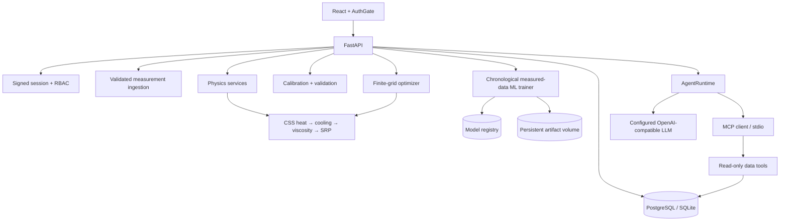

# PETRO-TWIN AI Canonical Architecture

**Last updated:** 2026-11-23. **Active runtime:** React 19 → FastAPI/Python → shared repository; Compose uses PostgreSQL 16 and local development uses SQLite. Spring Boot/Flyway is legacy source only.

## Service ownership

| Concern | Owner |
|---|---|
| UI, forms, navigation, visualizations and explicit loading/error states | React frontend |
| Authentication, authorization, validation, HTTP/WebSocket API and orchestration | FastAPI |
| CSV/JSON measurement ingestion, source quality, provenance and operational-data repository | FastAPI domain services + persistence |
| Digital-twin physics and CSS–SRP simulation coupling | Python physics modules |
| Scientific calibration, temporal validation and candidate records | Calibration services |
| Measured-data ML candidate training and registry | FieldProductionTrainingService + joblib artifacts |
| Finite-grid candidate comparison | ParetoOptimizer |
| Evidence-oriented tool-using investigation | AgentRuntime + read-only MCP server |
| Durable relational records | SQLite local / PostgreSQL Compose |
| Legacy Java proxy source | Dormant, not used by the canonical frontend |

## Connected runtime

## Frontend and API

React uses `frontend/src/services/api.ts` with one configurable base URL. Docker's Nginx proxy sends the health and application API routes to FastAPI. The AuthGate checks `/health`, validates an existing bearer session, renders login when required, and clears session state after a 401 response.

FastAPI owns all active HTTP API contracts. The Java service is not in Compose and is not a gateway. The API uses structured request validation, bounded query inputs, request correlation IDs, CORS allowlists and non-2xx errors instead of plausible-looking fallback data.

## Data and model lifecycle

Field mode does not seed synthetic wells. Measurement ingestion supports CSV/JSON with canonical-unit normalization, timestamp validation, VALID/SUSPECT quality status, provenance and duplicate/rejection handling. Manual ingestion is supported; live SCADA, historian, MQTT and OPC-UA adapters are not configured.

The shared coupled model composes existing simplified physics in the explicit sequence CSS heat/soak → peak thermal state → cooling → viscosity → SRP mechanics. Scenario and optimization responses expose the trace and state `SIMULATION_ONLY`, `field_eligible=false`, and `NOT_CALIBRATED_ON_FIELD_DATA`.

The calibration framework supports dataset pairing, identifiability, viscosity fitting and separate temporal validation. No field calibration has been performed. The ML trainer uses VALID measurements only, as-of feature vectors and future oil-rate targets, chronological 60/20/20 splits, validation-based Ridge selection, untouched chronological test metrics and comparison with persistence. A model that beats persistence by the configured gate becomes a review candidate, not an active model. An administrator explicitly promotes a SHA-256-verified artifact. Field inference requires a promoted artifact and fresh VALID sensor inputs. Chronological holdout does not establish field validation.

## Agents and MCP

AgentRuntime opens the project's MCP server via stdio, retrieves registered well evidence, filters for read-only/non-destructive tool annotations, rechecks every tool call against the allowlist, and invokes a configured OpenAI-compatible LLM. It persists the answer and full tool/evidence trace. It has no mutation or control tools and fails closed if no model provider is configured. The older deterministic supervisor is retained for simulation/demo actions only. The system is not an official AssetOpsBench benchmark implementation.

## Persistence and migrations

The repository initializes versioned schema migrations. Tables cover wells, measurements, sources, analysis runs, operational events, calibration datasets/runs/candidates, auth accounts/sessions/audit events, agent runs and the field model registry. Compose named volumes retain PostgreSQL and field-model artifacts. The API verifies artifact hashes before model activation/inference.

## Authentication and role policy

Local development may use `PETROTWIN_AUTH_MODE=disabled`. The production overlay requires `PETROTWIN_AUTH_MODE=required` and a `PETROTWIN_JWT_SECRET` of at least 32 bytes. Passwords use salted scrypt hashes; access JWTs are HMAC-SHA256 signed and tied to revocable DB sessions. Roles: viewer, engineer, operator and admin. Read access is available to all authenticated roles; field ingestion to operator/admin; physics/calibration analysis to engineer/admin; user management, policy/approval actions and model promotion to admin. First admin is provisioned with `scripts/manage_users.py`; no default credentials exist.

Before public exposure, deployment-specific TLS, edge rate limiting, CSP, secret-manager integration, backup/recovery and independent security testing must be configured. MFA and OIDC/SSO are not implemented.

## Scope and validation boundary

No field dataset, field adapter credentials, model field-validation report or production cloud deployment is present. The application is not an operating control system; recommendations are decision-support candidates only. Formation fracture pressure, gearbox torque and API allowable stress are not optimizer constraints at this stage.
